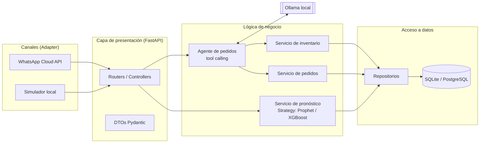

# 🍽️ Restaurant Ops Agent

Agente de IA **100 % local** para la operación de un restaurante: recibe pedidos por **WhatsApp** usando *tool calling*, consulta el **inventario** por API antes de confirmar y **pronostica la demanda** con Prophet y XGBoost para anticipar compras.

> Proyecto de portafolio construido con arquitectura en capas, patrones de diseño y SOLID. El agente corre en **Ollama**, sin APIs de pago.

---

## 🎯 Problema que resuelve

Los restaurantes pequeños y medianos toman pedidos por WhatsApp a mano, sin saber en tiempo real si tienen los ingredientes y sin datos para planear compras. Eso produce:

- Pedidos confirmados que luego no se pueden preparar por falta de insumos.
- Desperdicio por comprar de más, o quiebres de stock por comprar de menos.
- Tiempo del personal dedicado a responder mensajes repetitivos.

**Restaurant Ops Agent** automatiza ese flujo:

1. El cliente escribe por WhatsApp en lenguaje natural ("2 hamburguesas y una limonada").
2. El agente (LLM local) decide qué **herramientas** llamar: consultar menú, verificar inventario, crear pedido.
3. El inventario se descuenta según la receta de cada plato.
4. Un módulo de ML pronostica la demanda por plato y sugiere compras de insumos.

---

## 🏗️ Arquitectura



### Estructura de carpetas

```
restaurant-ops-agent/
├── app/
│   ├── main.py              # App factory de FastAPI
│   ├── core/                # Configuración, logging y transversales
│   ├── api/
│   │   ├── dependencies.py  # Composition root (inyección de dependencias)
│   │   ├── routes/          # Controllers REST
│   │   └── schemas/         # DTOs de entrada/salida
│   ├── services/            # Lógica de negocio
│   ├── repositories/        # Acceso a datos           (Paso 2)
│   ├── domain/              # Entidades y modelos ORM   (Paso 2)
│   ├── agents/              # Agente Ollama + tools     (Paso 3)
│   ├── channels/            # WhatsApp / simulador      (Paso 4)
│   └── forecasting/         # Prophet / XGBoost         (Paso 5)
├── tests/
├── data/                    # Base de datos local (ignorada por git)
├── .env.example
├── requirements.txt
└── requirements-dev.txt
```

---

## 🧩 Patrones de diseño y principios aplicados

| Patrón / Principio | Dónde | Para qué |
|---|---|---|
| **Singleton** (cacheado) | `app/core/config.py` → `get_settings()` | La configuración se lee una sola vez por proceso |
| **Factory** | `app/main.py` → `create_app()` | Crear instancias aisladas de la app (tests, scripts) |
| **Dependency Injection** | `app/api/dependencies.py` | Los controllers reciben servicios, no los construyen |
| **Composite / Strategy** de health checks | `app/services/health_service.py` | Agregar chequeos nuevos (BD, WhatsApp) sin tocar el servicio |
| **DTO** | `app/api/schemas/` | Separar el contrato HTTP de los modelos internos |
| **DIP (SOLID)** | `HealthService` depende del `Protocol` `HealthCheck` | Las abstracciones no dependen de implementaciones |
| **Repository** | `app/repositories/` | *(Paso 2)* |
| **Adapter** | `app/channels/` | *(Paso 4)* WhatsApp y simulador detrás de la misma interfaz |
| **Strategy** | `app/forecasting/` | *(Paso 5)* Cambiar entre Prophet y XGBoost |

---

## 🛠️ Tecnologías

| Área | Tecnología |
|---|---|
| Backend | Python 3.12, FastAPI, Pydantic v2 |
| Base de datos | SQLite (desarrollo) → PostgreSQL (producción), SQLAlchemy 2 |
| IA local | Ollama + `qwen3:14b` (tool calling) |
| Mensajería | WhatsApp Cloud API (Meta) + simulador local |
| Pronóstico | Prophet, XGBoost, pandas |
| Calidad | pytest, ruff |

Todo el stack es gratuito y de código abierto. WhatsApp Cloud API es gratis para desarrollo con el número de prueba de Meta.

---

## 🔌 Endpoints

| Método | Ruta | Descripción |
|---|---|---|
| `GET` | `/health` | *Liveness*: la app está viva |
| `GET` | `/health/ready` | *Readiness*: verifica Ollama y el modelo configurado (`503` si algo falla) |
| `GET` | `/docs` | Swagger UI (deshabilitado en producción) |

---

## 🚀 Cómo ejecutarlo (Windows)

**Requisitos:** Python 3.11 o 3.12 y [Ollama](https://ollama.com).

```powershell
# 1. Clonar y entrar
git clone https://github.com/<tu-usuario>/restaurant-ops-agent.git
cd restaurant-ops-agent

# 2. Entorno virtual
python -m venv .venv
.venv\Scripts\activate

# 3. Dependencias
pip install -r requirements-dev.txt

# 4. Variables de entorno
copy .env.example .env

# 5. Modelo local
ollama pull qwen3:14b

# 6. Levantar la API
uvicorn app.main:app --reload
```

Abre http://localhost:8000/docs y prueba `GET /health/ready`.

### Pruebas

```powershell
pytest -v
ruff check .
```

---

## 🗺️ Hoja de ruta

- [x] **Paso 1:** Estructura, configuración, health checks y pruebas
- [ ] **Paso 2:** Modelos de dominio, base de datos y repositorios (menú, recetas, inventario, pedidos)
- [ ] **Paso 3:** Servicios de negocio y agente Ollama con *tool calling*
- [ ] **Paso 4:** Canales de mensajería (simulador + WhatsApp Cloud API) y webhook
- [ ] **Paso 5:** Pronóstico de demanda con Prophet y XGBoost
- [ ] **Paso 6:** Demo, métricas y despliegue
