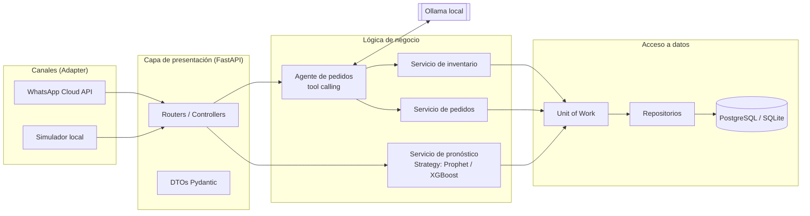
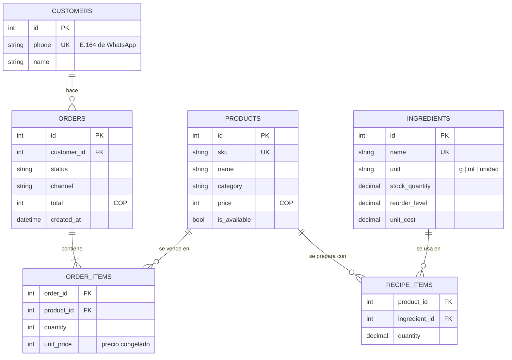

# 🍽️ Restaurant Ops Agent

Agente de IA **100 % local** para la operación de un restaurante de comidas rápidas: recibe pedidos por **WhatsApp** usando *tool calling*, consulta el **inventario** antes de confirmar y **pronostica la demanda** con Prophet y XGBoost para anticipar compras.

> Proyecto de portafolio construido con arquitectura en capas, patrones de diseño y SOLID. El agente corre en **Ollama**, sin APIs de pago.

---

## 🎯 Problema que resuelve

Los restaurantes pequeños y medianos toman pedidos por WhatsApp a mano, sin saber en tiempo real si tienen los ingredientes y sin datos para planear compras. Eso produce:

- Pedidos confirmados que luego no se pueden preparar por falta de insumos.
- Desperdicio por comprar de más, o quiebres de stock por comprar de menos.
- Tiempo del personal dedicado a responder mensajes repetitivos.

**Restaurant Ops Agent** automatiza ese flujo:

1. El cliente escribe por WhatsApp en lenguaje natural ("regálame dos perros sin cebolla y una gaseosa").
2. El agente (LLM local) decide qué **herramientas** llamar: consultar menú, verificar inventario, crear pedido.
3. El inventario se descuenta según la **receta** de cada producto, en una sola transacción.
4. Un módulo de ML pronostica la demanda por producto y sugiere compras de insumos.

---

## 🏗️ Arquitectura



### Modelo de datos



**Decisiones de diseño:**
- **Precio congelado en `order_items.unit_price`**: si el menú cambia de precio, los pedidos históricos y los datos del pronóstico no se alteran.
- **Recetas como tabla intermedia**: un combo reutiliza ingredientes de varios productos y el inventario se descuenta exacto por gramo, mililitro o unidad.
- **Enums como `VARCHAR + CHECK`** en vez de `ENUM` nativo de PostgreSQL: agregar un estado nuevo no exige alterar un tipo, y SQLite se comporta igual.

### Estructura de carpetas

```
restaurant-ops-agent/
├── app/
│   ├── main.py                  # App factory de FastAPI
│   ├── core/
│   │   ├── config.py            # Settings tipados desde .env
│   │   ├── database.py          # Engine y fábrica de sesiones
│   │   └── logging.py
│   ├── api/
│   │   ├── dependencies.py      # Composition root (inyección de dependencias)
│   │   ├── routes/              # Controllers REST
│   │   └── schemas/             # DTOs de entrada/salida
│   ├── domain/
│   │   ├── enums.py             # Categorías, unidades, estados
│   │   └── models.py            # Entidades ORM con reglas de negocio
│   ├── repositories/
│   │   ├── interfaces.py        # Contratos (Protocols)
│   │   ├── sqlalchemy_repositories.py
│   │   ├── unit_of_work.py      # Transacciones de negocio
│   │   └── seed.py              # Menú de comidas rápidas de ejemplo
│   ├── services/                # Lógica de negocio
│   ├── agents/                  # Agente Ollama + tools     (Paso 3)
│   ├── channels/                # WhatsApp / simulador      (Paso 4)
│   └── forecasting/             # Prophet / XGBoost         (Paso 5)
├── scripts/init_db.py           # Crea el esquema y carga el menú
├── tests/
├── docker-compose.yml           # PostgreSQL 17 + pgAdmin
├── .env.example
├── requirements.txt
└── requirements-dev.txt
```

---

## 🧩 Patrones de diseño y principios aplicados

| Patrón / Principio | Dónde | Para qué |
|---|---|---|
| **Repository** | `app/repositories/sqlalchemy_repositories.py` | Aislar las consultas SQL; los servicios no conocen SQLAlchemy |
| **Unit of Work** | `app/repositories/unit_of_work.py` | Crear el pedido y descontar inventario en una sola transacción |
| **Generic Repository** | `SqlAlchemyRepository[T]` | `get` y `add` escritos una vez para todas las entidades |
| **DIP (SOLID)** | `app/repositories/interfaces.py` | Los servicios dependen de `Protocol`s, no de implementaciones |
| **Rich Domain Model** | `Order.add_item()`, `Ingredient.consume()` | Las reglas de negocio viven en la entidad, no repartidas |
| **Singleton** (cacheado) | `get_settings()`, `get_engine()` | Una configuración y un pool de conexiones por proceso |
| **Factory** | `create_app()`, `build_engine()` | Crear instancias aisladas (tests, scripts) |
| **Dependency Injection** | `app/api/dependencies.py` | Los controllers reciben servicios, no los construyen |
| **Composite** de health checks | `app/services/health_service.py` | Agregar chequeos (BD, Ollama, WhatsApp) sin tocar el servicio |
| **DTO** | `app/api/schemas/` | Separar el contrato HTTP de los modelos internos |
| **Adapter** | `app/channels/` | *(Paso 4)* WhatsApp y simulador detrás de la misma interfaz |
| **Strategy** | `app/forecasting/` | *(Paso 5)* Cambiar entre Prophet y XGBoost |

---

## 🛠️ Tecnologías

| Área | Tecnología |
|---|---|
| Backend | Python 3.12, FastAPI, Pydantic v2 |
| Base de datos | PostgreSQL 17 (Docker), SQLAlchemy 2, psycopg 3 · SQLite como alternativa sin Docker |
| Infraestructura local | Docker Compose, pgAdmin 4 |
| IA local | Ollama + `qwen3:14b` (tool calling) |
| Mensajería | WhatsApp Cloud API (Meta) + simulador local |
| Pronóstico | Prophet, XGBoost, pandas |
| Calidad | pytest, ruff |

Todo el stack es gratuito y de código abierto. WhatsApp Cloud API es gratis para desarrollo con el número de prueba de Meta.

---

## 🔌 Endpoints

| Método | Ruta | Descripción |
|---|---|---|
| `GET` | `/health` | *Liveness*: la app está viva |
| `GET` | `/health/ready` | *Readiness*: verifica base de datos, Ollama y el modelo (`503` si algo falla) |
| `GET` | `/docs` | Swagger UI (deshabilitado en producción) |

---

## 🚀 Cómo ejecutarlo (Windows)

**Requisitos:** Python 3.12, [Docker Desktop](https://www.docker.com/products/docker-desktop/) y [Ollama](https://ollama.com).

```powershell
# 1. Clonar y entrar
git clone https://github.com/Santiagomc26/restaurant-ops-agent.git
cd restaurant-ops-agent

# 2. Entorno virtual y dependencias
py -3.12 -m venv .venv
.venv\Scripts\activate
pip install -r requirements-dev.txt

# 3. Variables de entorno
copy .env.example .env

# 4. Base de datos (PostgreSQL + pgAdmin en Docker)
docker compose up -d
python -m scripts.init_db

# 5. Modelo local
ollama pull qwen3:14b

# 6. Levantar la API
uvicorn app.main:app --reload
```

- API y Swagger: http://localhost:8000/docs
- pgAdmin: http://localhost:5050 (servidor `postgres`, usuario y clave del `.env`)

**Sin Docker:** en el `.env` usa `DATABASE_URL=sqlite:///./data/restaurant.db` y omite `docker compose up -d`.

### Pruebas

```powershell
pytest -v
ruff check .
```

Las pruebas usan SQLite en memoria, así que no necesitan Docker ni Ollama encendidos.

---

## 🗺️ Hoja de ruta

- [x] **Paso 1:** Estructura, configuración, health checks y pruebas
- [x] **Paso 2:** PostgreSQL en Docker, modelo de dominio, repositorios y Unit of Work
- [ ] **Paso 3:** Servicios de negocio y agente Ollama con *tool calling*
- [ ] **Paso 4:** Canales de mensajería (simulador + WhatsApp Cloud API) y webhook
- [ ] **Paso 5:** Pronóstico de demanda con Prophet y XGBoost
- [ ] **Paso 6:** Migraciones con Alembic, Dockerfile de la API y demo
